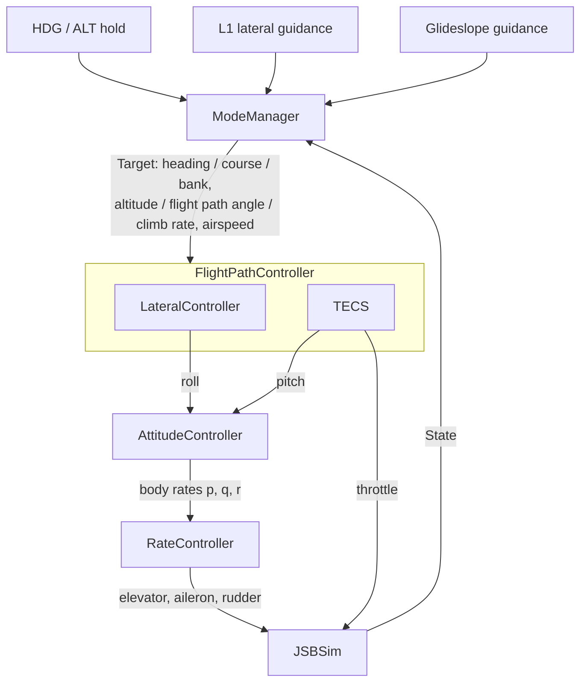

# Acessna

Exploring guidance algorithms for a Cessna 172 in JSBSim: waypoint route to final
approach course intercept to glideslope tracking to decision height. Verified with
Monte Carlo over wind, turbulence, and initial conditions.

Written in C++17 on the JSBSim flight dynamics library, with Python analysis and
FlightGear for visualization.

## Architecture



`Target` carries one active lateral command (`Target::lateral`, a variant of
`HeadingCommand`, `CourseCommand` or `BankCommand`) and one active vertical command
(`Target::vertical`, a variant of `AltitudeCommand`, `FlightPathCommand` or
`ClimbRateCommand`), plus `airspeed_kts`.

## Results

500 Monte Carlo runs (seeds 1–500) of a runway (KROA) approach:

- Start position ±300 m north and east, heading ±15°, altitude ±150 ft, airspeed ±10 kts
- Wind 0–20 kts from any direction
- Turbulence severity 0-3 (none to moderate, JSBSim)

| Metric | Mean | p95 | Max |
| --- | --- | --- | --- |
| Time to DH (s) | 102.0 | 114.2 | 120.6 |
| \|Cross-track\| at DH (m) | 0.4 | 1.2 | 4.4 |
| \|Glidepath deviation\| at DH (ft) | 6.3 | 23.6 | 63.9 |
| Max \|cross-track\|, FAF to DH (m) | 3.9 | 9.9 | 131.5 |
| Max \|glidepath deviation\|, capture to DH (°) | 0.2 | 0.6 | 1.4 |
| Localizer overshoot (°) | 0.8 | 1.7 | 3.9 |
| Max \|airspeed error\| below 1000 ft (kts) | 3.8 | 9.3 | 14.0 |
| Max sink below 1000 ft (fpm) | 1321 | 1800 | 2164 |
| Max bank (°) | 26.7 | 27.7 | 28.7 |
| Max sideslip (°) | 1.9 | 3.4 | 3.9 |

All runs captured the glideslope and reached DH. The nominal run reaches DH 0.1 m from the
centerline and 0.8 ft above the glidepath.

## Future additions

- Currently ends at decision height. I'd like to land the aircraft fully autonomously
  in the future.
- The autopilot reads the true state from JSBSim, with no sensor noise or state estimation.
  Adding sensor noise and an EKF would be more realistic.

## Development

### Prerequisites

- A C++17 compiler
- CMake 3.28 or newer
- Git (how else would you have gotten here)
- uv for the Python analysis scripts
- FlightGear 2024.1 (optional for visualization)
- LLVM clang-tidy and clang-format (optional for linting and formatting)

### Commands

```sh
# Configure (first time, or after editing CMakeLists.txt)
cmake -S . -B build

# Build
cmake --build build -j

# Fly the KROA runway 06 approach to decision height, writes run.csv
./build/acessna_run

# Monte Carlo: dispersed runs in parallel, writes monte_carlo.csv
./build/acessna_run --monte-carlo 200             # optional: --seed S --threads N

# Same flight with FlightGear: real time, writes run.csv
./scripts/flightgear.sh            # wait until the cockpit view is up, then continue
./build/acessna_run --flightgear

# Test (GoogleTest via ctest)
ctest --test-dir build --output-on-failure

# Lint (clang-tidy)
./scripts/lint.sh

# Format (clang-format)
./scripts/format.sh                 # format
./scripts/format.sh --check         # list unformatted code changing nothing

# Plot a run
uv run analysis/plot_run.py run.csv                 # interactive window
uv run analysis/plot_run.py run.csv --save run.png  # image file
```

### Conventions

- Surfaces are normalized `[-1, 1]`; throttle/mixture/flaps `[0, 1]`; values are clamped
- `+elevator` = nose down, `+aileron` = roll right, `+rudder` = yaw right
- Angles in degrees, rates in deg/s, altitude in ft, speeds in kts, `vs_fpm` in ft/min,
  `north_m`/`east_m` are meters from the start point
- `control_hz` must evenly divide `sim_hz` (default 60 / 120 Hz)
- Controllers add their corrections to the trim positions passed to `reset()`

## License

MIT
