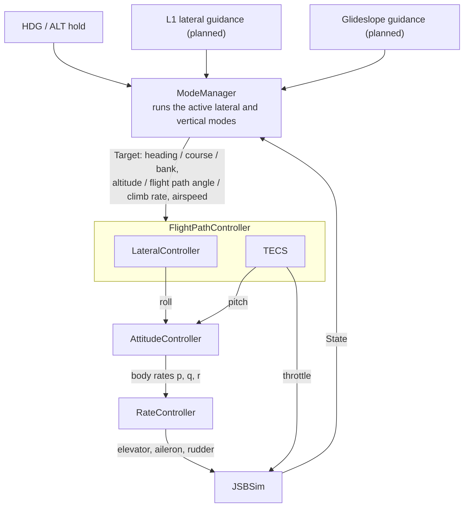

# Acessna

Exploring guidance algorithms for a Cessna 172 in JSBSim: waypoint route to final
approach course intercept to glideslope tracking to decision height. Verified with
Monte Carlo over wind, turbulence, and initial conditions.

Written in C++17 on the JSBSim flight dynamics library, with Python analysis and
FlightGear for visualization.

## Status

- [x] JSBSim C++ wrapper, closed-loop harness, CSV logging, GoogleTest suite
- [x] Controller architecture: mode manager with heading / altitude hold modes, TECS, lateral, attitude and rate layers (interfaces and stubs)
- [x] Telemetry: controller signals logged as extra CSV columns
- [x] FlightGear visualization and Python log plotting
- [x] Multithreaded, seed-reproducible Monte Carlo runner
- [ ] Control laws: PID and filters, rate and attitude loops, TECS, lateral flight-path control
- [ ] Lateral guidance (L1) with fly-by waypoint transitions
- [ ] Glideslope guidance and approach mode logic
- [ ] Monte Carlo scenarios (wind, turbulence, initial conditions) and requirements verification

## Architecture



## Requirements

| ID | Requirement | Verified by | Result |
| --- | --- | --- | --- |
| GDN-01 | Flies well | Monte Carlo | TBD |

## Results

TBD

## Future additions

- Currently ends at decision height. I'd like to land the aircraft fully autonomously
  in the future.
- The autopilot reads the true state from JSBSim, with no sensor noise or state estimation.
  Adding sensor noise and an EKF would be more realistic.

## Development

### Prerequisites

- A C++17 compiler
- CMake 3.28 or newer
- Git (how else would you have gotten here)
- [uv](https://docs.astral.sh/uv/) for the Python analysis scripts
- FlightGear 2024.1 (optional for visualization)

### Commands

```sh
# Configure (first time, or after editing CMakeLists.txt)
cmake -S . -B build

# Build
cmake --build build -j

# Run headless: 60 s of sim time, writes run.csv
./build/acessna_run

# Run with FlightGear: real time until the aircraft hits the ground, writes run.csv
./scripts/flightgear.sh            # wait until the cockpit view is up, then continue
./build/acessna_run --flightgear

# Test (GoogleTest via ctest)
ctest --test-dir build --output-on-failure

# Plot a run
uv run analysis/plot_run.py run.csv                 # interactive window
uv run analysis/plot_run.py run.csv --save run.png  # image file
```

### Layout

| Path | Description |
| --- | --- |
| `src/main.cpp` | Entrypoint: configures the run and flies `Autopilot` |
| `math` | Unit conversions and `wrap_180` / `wrap_360` |
| `telemetry` | `Telemetry` signal recorder and the `TelemetrySource` mixin |
| `sim/sim` | `C172Sim`: JSBSim wrapper, `InitialConditions`, `Controls`, `State` |
| `sim/harness` | `run(controller, RunConfig)` closed-loop runner, CSV logging |
| `sim/controller` | `Controller` interface the harness flies |
| `sim/monte_carlo` | `run_monte_carlo`: runs seeded scenarios in parallel (header only) |
| `autopilot/autopilot` | `Autopilot : Controller`: wires the layers below together |
| `autopilot/mode_manager` | `ModeManager`: engages modes, runs their transitions and fills `Target` from the active lateral and vertical modes |
| `autopilot/modes` | `LateralMode` / `VerticalMode` interfaces and the `HeadingHold` / `AltitudeHold` modes |
| `guidance/` | Guidance laws (planned, empty): command sources the modes use (L1, glideslope) |
| `control/setpoints` | `Target`, `AttitudeSetpoint`, `TecsOutput`, `FlightPathOutput`, `RateSetpoint`, `SurfaceCommands`: the data passed between layers |
| `control/pid` | `Pid` with integrator limits and bumpless reset |
| `control/filters` | `LowPassFilter`, `RateLimiter` |
| `control/flight_path_controller` | `FlightPathController`: `Target` -> `AttitudeSetpoint` + throttle, runs the two below |
| `control/tecs` | `Tecs`: longitudinal, airspeed + altitude / flight path angle / climb rate -> pitch setpoint + throttle |
| `control/lateral_controller` | `LateralController`: lateral, heading / course / bank -> roll setpoint |
| `control/attitude_controller` | `AttitudeController`: `AttitudeSetpoint` -> `RateSetpoint` (p, q, r) |
| `control/rate_controller` | `RateController`: `RateSetpoint` -> elevator/aileron/rudder |
| `analysis/` | Python analysis of run logs |
| `scripts/` | Helper scripts (FlightGear launch) |
| `tests/` | GoogleTest tests |

`Target` carries one active lateral command (`Target::lateral`, a variant of
`HeadingCommand`, `CourseCommand` or `BankCommand`) and one active vertical command
(`Target::vertical`, a variant of `AltitudeCommand`, `FlightPathCommand` or
`ClimbRateCommand`), plus `airspeed_kts`.

### Conventions

- Surfaces are normalized `[-1, 1]`; throttle/mixture/flaps `[0, 1]`; values are clamped
- `+elevator` = nose down, `+aileron` = roll right, `+rudder` = yaw right
- Angles in degrees, rates in deg/s, altitude in ft, speeds in kts, `vs_fpm` in ft/min,
  `north_m`/`east_m` are meters from the start point
- `control_hz` must evenly divide `sim_hz` (default 60 / 120 Hz)
- Controllers add their corrections to the trim positions passed to `reset()`

## License

MIT
